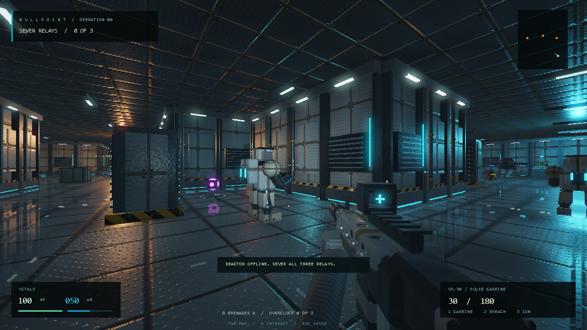

# NULLPOINT

A complete native Windows single-player FPS in **93,696 bytes**. Explore a hostile reactor facility, find weapon upgrades, sever three relays, destroy the Warden, and defend extraction.

**[Download NULLPOINT.exe](https://github.com/n30nex/NULLPOINT/raw/refs/heads/main/bin/NULLPOINT.exe)** · [Research and measurements](docs/RESEARCH.md) · [Manual](docs/Manual.txt)


## Play

Download the executable, open it, and press **Enter**. Requires 64-bit Windows 10/11 and a graphics driver supporting OpenGL 2.1 with framebuffer objects. The game runs offline using Windows system libraries; no installation, external game assets, or additional DLL downloads are needed.

The Service and Armory side wings contain optional **overclock cells**. A third is in containment. Each adds 15% of base weapon/grenade damage and supplies two grenades. Orange energy barrels explode and can start chain reactions. After defeating the Warden, hold the green extraction bay for six seconds while reinforcements attack.

| Control | Action |
| --- | --- |
| WASD / mouse | Move and strafe / look |
| Left / right click | Fire / aim |
| 1 / 2 / 3 or wheel | Carbine / shotgun / ion lance |
| G | Throw a bouncing grenade; 2.1-second fuse |
| R / E | Reload / use a relay |
| Shift / Space / Ctrl | Sprint / jump / crouch |
| Hold Tab | Facility map |
| Escape | Pause and release the mouse |
| F11 | Borderless fullscreen |
| M / End | Mute / quit |

Choose Recruit, Operative, or Veteran with the title screen's left/right arrows. Arrow keys also aim during play, and F fires. The pause menu provides mouse sensitivity, rendering quality, and restart controls. Losing focus pauses the game. Choose Performance with Q in the pause menu, or launch with `--performance`, to reduce internal render resolution.

## Research-driven expansion

- **Gameplay:** two additional side wings, three permanent damage upgrades, bouncing grenades, ten destructible barrels, chain reactions, and extraction defense. The complete route contains **39 enemies**, including the boss and reinforcements.
- **Physics:** fixed 120 Hz simulation, acceleration/friction, air control, buffered jumps, a short coyote-time allowance, crate landings, grenade restitution and damping, blast knockback, and wall-aware blast propagation.
- **Graphics:** generated bevel geometry, cached meshes, roughness-aware GGX-style lighting, procedural surface relief, worn paint, brushed metal, local light haze, contact shading, HDR bloom, and clipped planar floor reflections at half resolution.
- **Animation:** movement-driven strides, articulated Warden legs and pistons, drone rotors, machinery, hit flinches, death animations, weapon sway, aligned aiming, recoil/reloads, and grenade-throw motion.
- **Presentation:** synthesized music and effects, vitals/ammunition, objective and extraction progress, overclock/grenade counters, and a camera-consistent map.



## The byte budget

| Build | Executable bytes | Free below 96,000 |
| --- | ---: | ---: |
| Previous graphics update | 95,232 | 768 |
| Compacted baseline before expansion | 84,992 | 11,008 |
| **Expanded game** | **93,696** | **2,304** |

The final game is **1,536 bytes smaller** than the previous version despite its expanded content. It is an ordinary native PE executable: machine code is not packed, extracted, downloaded, or launched through a wrapper. Embedded shader text uses Windows MSZIP compression and expands in memory at startup, shrinking from 5,973 to 2,684 bytes. Generated geometry, cached uniforms/meshes, compact data tables, and a measured internal calling convention save further space and repeated work.

The limit applies to `bin/NULLPOINT.exe`. Screenshots, documentation, source, and developer tests are optional and are not loaded by the game. Artwork and music are generated at runtime; text uses installed Windows fonts.

## Build

On Windows, place **Python 3** and **x86_64 MinGW-w64 GCC** on `PATH`, then run:

```powershell
.\build.ps1
```

This packages `shaders.glsl` with the Windows Compression API, validates its compression round trip, and builds `NULLPOINT.exe` beside the source. No Python packages are required. An optional `-OutputPath` chooses another destination. A candidate of 96,000 bytes or more is rejected before replacing the destination.

The verified compiler is GCC 13.2.0 with `-Oz`. Another compiler or Windows codec version may change size/hash. Zero-initialized data remains in BSS; `-fdata-sections` is intentionally omitted. Internal helpers use GCC's System V ABI attribute; Win32 callbacks and imported APIs retain their Windows ABI. Edit readable GLSL, not generated `build/shaders.h`.

## Verify

```powershell
.\verify.ps1
```

This builds the shipping game and a separate developer test executable, then runs:

- **26 gameplay/physics checks**, including frame-rate independence, crate landings, buffered input, grenade bounce, chain reactions, and collision removal.
- Complete campaigns on **all three difficulties**, collecting all three upgrades, throwing grenades, defeating all 39 enemies, and completing extraction.
- **20 camera-relative input checks** and OpenGL/animated-combat checks inside the exact shipping executable.
- Eight native captures checked for completeness and the invalid-lighting regression found during development.

All checks pass. Scripted campaigns use perfect aim; they are functional coverage rather than human balance testing. Full and Performance rendering modes were both checked. Detailed lighting and the mirrored scene increase graphics work; samples and limitations are in the research notes. No faster gameplay-FPS claim is implied.

Developer diagnostics are separate and may exceed 96 KB. They are **not** the challenge entry. The shipping game accepts `--verify` to produce `graphics.txt` and eight BMP captures in a writable working directory. `--selftest` and `--playtest` belong to the developer executable generated with `build.ps1 -Diagnostics`.

## Integrity

SHA-256 of `bin/NULLPOINT.exe`:

```text
1320a9a63c79eacda71b76c97eb57c6ab5ef901fec19e83b742bb4c738c20cc9
```

Inspired by [.kkrieger](https://simple.wikipedia.org/wiki/.kkrieger). No .kkrieger code or artwork is included. No contest submission or validation against additional event-specific rules has been performed.
