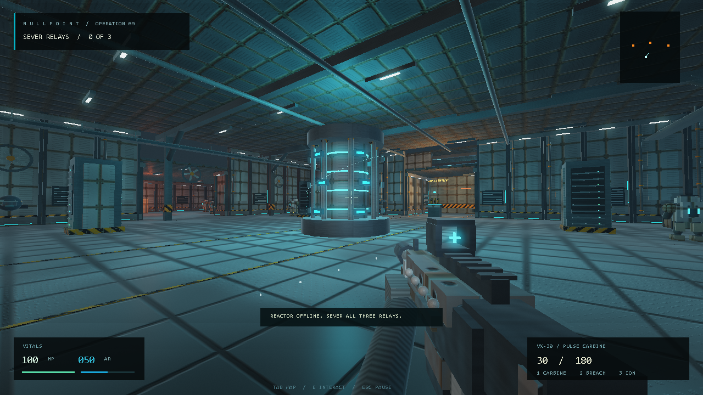
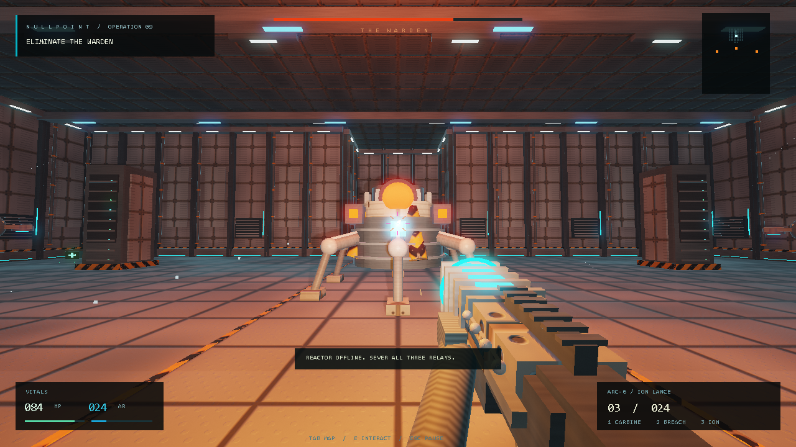

# NULLPOINT

A native Windows single-player FPS in **95,232 bytes**. Inspired by the procedural size challenge of [.kkrieger](https://simple.wikipedia.org/wiki/.kkrieger).

**[Download NULLPOINT.exe](https://github.com/n30nex/NULLPOINT/raw/refs/heads/main/bin/NULLPOINT.exe)** · [Full manual](docs/Manual.txt)



## Play

Download the executable and open it. Press **Enter** to start. Requires 64-bit Windows 10/11 and a graphics driver supporting OpenGL 2.1 with framebuffer objects. No installation, network connection, external game assets, or additional DLL downloads are needed.

Sever the facility's three power relays, destroy the Warden, and reach extraction.

| Control | Action |
| --- | --- |
| WASD | Move and strafe |
| Mouse | Look |
| Left / right click | Fire / aim |
| 1 / 2 / 3 or mouse wheel | Select weapon |
| R | Reload |
| E | Use a relay |
| Shift / Space / Ctrl | Sprint / jump / crouch |
| Hold Tab | Map |
| Escape | Pause and release the mouse |
| F11 | Borderless fullscreen |
| M / End | Mute / quit |

Choose Recruit, Operative, or Veteran using the title screen's left/right arrows. Arrow keys also aim during play, and F fires. The pause menu includes mouse sensitivity and render resolution settings. Losing focus pauses the game.

## Inside 96 KB

- Three weapons: pulse carbine, breach shotgun, and ion lance.
- Three ordinary enemy classes, relay reinforcements, and a six-legged boss: 25 enemies in total.
- A reactor complex with procedural architecture, metal panels, pipework, gantries, machinery, and signs.
- HDR lighting with soft, two-pass bloom, headlamp shadows, surface relief, brushed metal, worn paint, damp floors, fog, and sparks.
- Rotating fans, reactor machinery, articulated Warden legs, movement-driven robot strides, drone rotors, death animations, and mechanical weapon recoil/reloads.
- Synthesized music and sound effects, armor, pickups, a map, and complete loss/restart/extraction states.

The limit applies to the **uncompressed executable**: 95,232 bytes, leaving 768 bytes below the strict 96,000-byte ceiling. The screenshot, documentation, and source are optional and are not loaded by the game. Fonts and DLLs come from Windows. No executable packer or downloader is used.

## Build

Install an x86_64 MinGW-w64 GCC toolchain and make `gcc` available on `PATH`. From PowerShell in the repository:

```powershell
.\build.ps1
```

This creates `NULLPOINT.exe` beside the source. To choose an output:

```powershell
.\build.ps1 -OutputPath 'C:\path\to\NULLPOINT.exe'
```

The build rejects a binary of 96,000 bytes or more. The committed executable was built with GCC 13.2.0; another compiler version may produce a different size or hash. Zero-initialized buffers must remain in BSS, so the build intentionally omits `-fdata-sections`.

## Verification

The executable contains optional diagnostics. They write results into the current working directory and return a nonzero exit code on failure. Run them in a writable folder:

```powershell
$exe = (Resolve-Path '.\bin\NULLPOINT.exe').Path
foreach ($check in '--selftest', '--playtest', '--verify') {
    $process = Start-Process -FilePath $exe -ArgumentList $check -Wait -PassThru
    if ($process.ExitCode -ne 0) { throw "$check failed: $($process.ExitCode)" }
}
```

- `--selftest`: 17 gameplay checks covering collision, ammunition, damage, objectives, extraction, death, and restart.
- `--playtest`: a deterministic Recruit campaign using ordinary movement, combat, pickups, damage, and relay interactions. Completes all three relays, defeats all 25 enemies, and extracts without teleportation or invulnerability. Its perfect aim is not a substitute for human difficulty testing.
- `--verify`: 16 movement checks against the actual rendered camera basis, four mouse-direction checks, OpenGL error checks, six native render captures including animated combat, and a short rendering benchmark. Requires a working graphics driver.

All checks passed on the committed executable. The corrected controls include standard horizontal mouse look, camera-relative strafing, and matching arrow-key yaw.

## Graphics update and compactness

The richer build uses only **2,560 additional bytes** compared with the first release. Model parts are stored as compact signed-byte tables, cube geometry uses indexed corners, and smooth sphere geometry is generated once and reused. Geometry calculations use single precision while the audio synthesizer retains its double-precision time/oscillator path. Enemies outside a conservative view boundary are skipped in both render passes; steep camera angles and wide windows retain a wider boundary.

The shader now computes material coordinates in the vertex stage and uses compact 2D noise instead of repeated 3D noise and per-fragment inverse-matrix work. Bloom is blurred in two passes at one-quarter width and height. Floating-point render targets preserve bright lighting before tone mapping; an 8-bit fallback is provided for drivers that cannot render to the floating-point format.

| Native 1280x720 render benchmark | Previous build | Graphics update |
| --- | ---: | ---: |
| Trial 1, ms/frame | 3.40 | 3.19 |
| Trial 2, ms/frame | 24.30 | 3.35 |
| Trial 3, ms/frame | 4.10 | 3.37 |
| Median, ms/frame | **4.10** | **3.35** |
| Uncompressed executable | 92,672 bytes | 95,232 bytes |

Measured on a GTX 1060 6GB with driver 576.52, using the same 90-frame Warden-arena renderer benchmark after native capture checks. The previous build had one timing outlier; the comparison uses medians. These are short rendering samples, not sustained gameplay or display-refresh guarantees. The final candidate also passed the 17 gameplay checks, 20 movement/mouse checks, OpenGL and animated-combat rendering checks, and a complete Recruit campaign.



## Executable integrity

SHA-256 of `bin/NULLPOINT.exe`:

```text
59d7ab303f75a125744a8029134b4bfd7bd30692bd3da350c9ed8ca7aaa29f85
```

This is an original game; no .kkrieger code or artwork is included. It has not been submitted to a contest or checked against any additional event rules.
